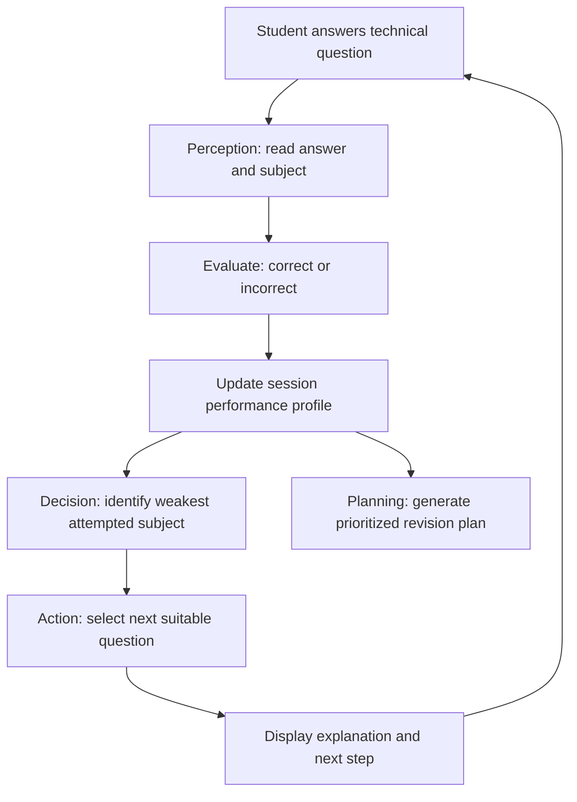

# MechPrep Development Schema

## 1. Purpose
Create an agent that helps a mechanical engineering student prepare for placement assessments by diagnosing weak technical subjects, choosing suitable follow-up questions and planning revision.

## 2. Architecture

## 3. Input schema
Each question contains:
- `id`: unique string identifier
- `subject`: subject category
- `difficulty`: Easy, Medium or Hard
- `question`: question text
- `options`: list of answer options
- `answer`: correct option
- `explanation`: explanation displayed after the answer

Each answer record stores the question ID, subject, chosen option, correctness and difficulty.

## 4. Decision policy
1. Record the student's answer.
2. Calculate the percentage correct for every attempted subject.
3. Identify the weakest attempted subject.
4. Select an unanswered question from that subject where possible.
5. After a wrong answer, prefer an easier reinforcement question; after a correct answer, prefer a harder question.
6. Generate a revision plan ordered from lower diagnostic performance to higher performance.

## 5. Agent characteristics
- Goal-oriented: improve placement readiness.
- Perception: receives quiz answers.
- State: stores answers and scores during the current app session.
- Reasoning: compares subject-level performance.
- Action: selects a follow-up question and creates a revision plan.
- Feedback: correctness changes the performance profile and subsequent choice.
- Explainability: shows the correct answer and a brief reason.

## 6. PEAS
- **Performance measure:** relevant follow-up questions, clear feedback, prioritized revision and accurate score calculations.
- **Environment:** mechanical placement practice session.
- **Actuators:** next question, explanation, skill profile and revision plan.
- **Sensors:** student's selected answers and chosen placement goal.

## 7. Test cases
1. A correct answer increases the correct count for its subject.
2. An incorrect answer increases attempted count but not correct count.
3. Weakest attempted subject is identified from diagnostic scores.
4. An unanswered question from the weak subject is selected where available.
5. The revision plan includes the selected number of days and daily study time.
6. The app can run without an external API key.

## 8. Scope and limitations
The prototype uses a fixed question bank and transparent rules. Scores are only a small diagnostic sample, not a validated measure of employability. Data is stored in Streamlit session state and is not permanently saved.
